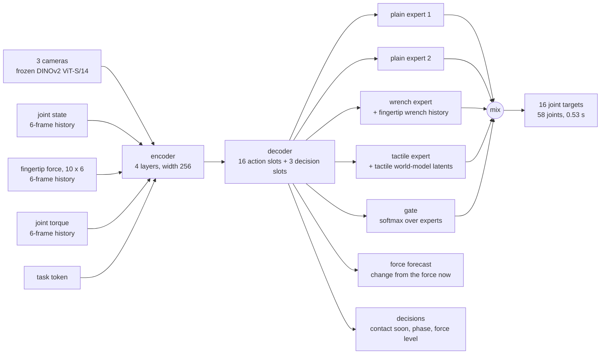
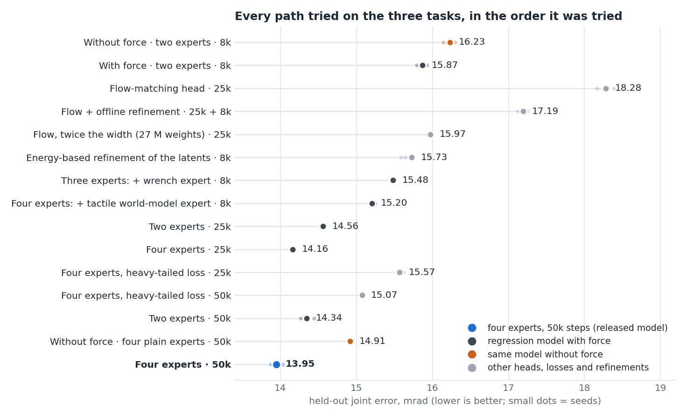
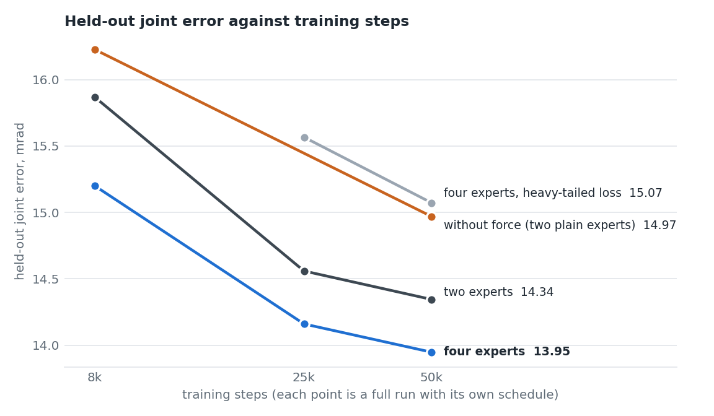
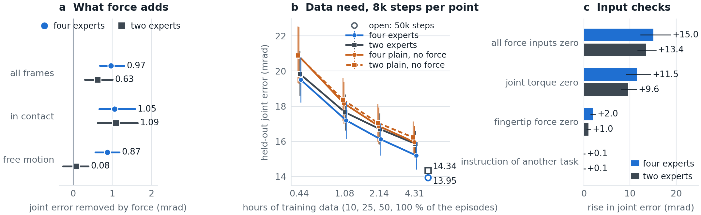
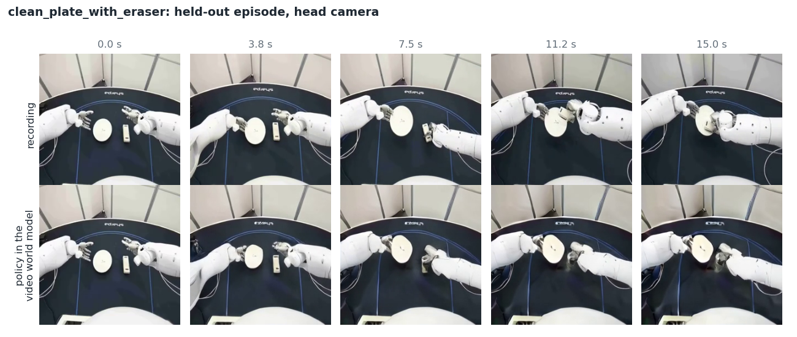
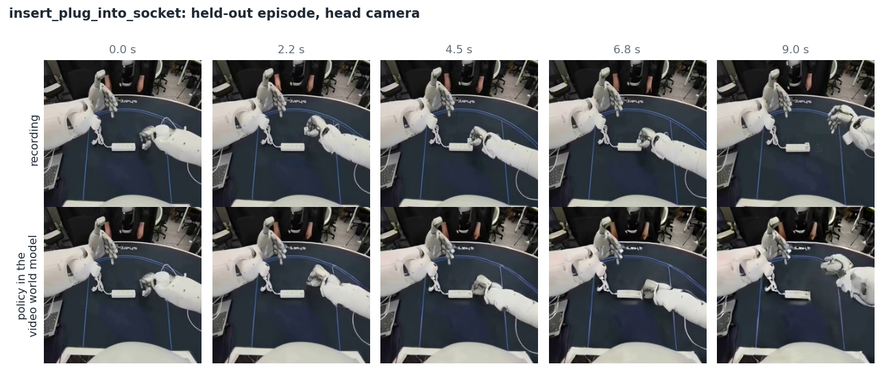
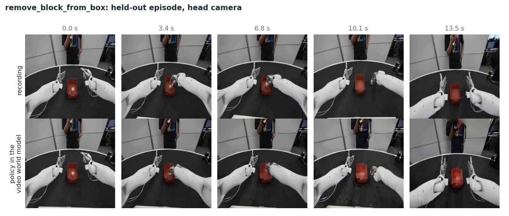
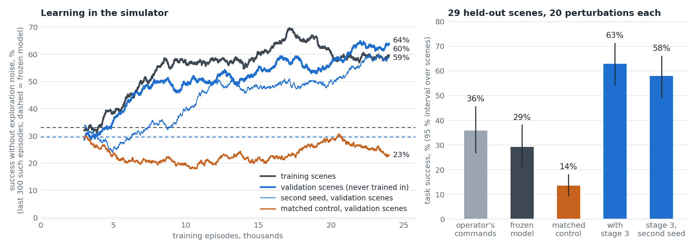
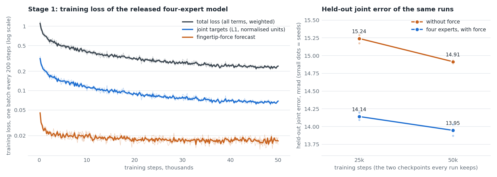
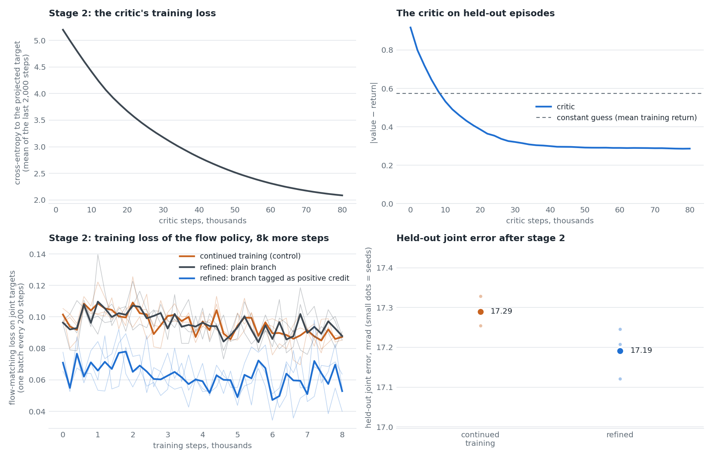

# Results

A small policy for two five-finger hands that reads cameras, joint state and contact force, and predicts the next joint
targets together with the fingertip force it expects. Trained and evaluated on three tasks of the public SharpaDex dataset
(`clean_plate_with_eraser`, `insert_plug_into_socket`, `remove_block_from_box`): 1,032 training episodes (4.31 h) and 115
held-out episodes that are never trained on.

**The released model is the four-expert model trained for 50,000 steps. On the held-out episodes its joint error is
13.95 mrad; the same model without force reaches 14.91 mrad.** Every other path tried in this project ended above it.
The second-best approach, the two-expert model at the same budget, reaches 14.34 mrad.

Task success was measured in one place only, a physics simulation of `clean_plate_with_eraser`: there, corrections
learned from reward around the frozen model raise success on scenes never trained in from 29 % to 63 % (58 % in a second
training run; section 7).

Checkpoints: [huggingface.co/josyula/sharpadex-force-policy](https://huggingface.co/josyula/sharpadex-force-policy).

All numbers of sections 1 to 6 are mean absolute errors on the held-out episodes, mean of 3 training seeds. Intervals are 95 %
bootstrap intervals over held-out episodes and seeds. "In contact" means any fingertip force above 1 N.

Contents: [the result](#1-the-result) · [the model](#2-the-model) · [the paths taken](#3-the-paths-taken) ·
[ablation of the released model](#4-ablation-of-the-released-model) · [data need](#5-data-need) ·
[world models](#6-world-models) · [stage 3 in simulation](#7-stage-3-corrections-learned-in-a-physics-simulation) ·
[limits](#8-limits) · [reproduce](#9-reproduce)

## 1. The result

| Model, 50,000 steps | Joint error (mrad) | In contact | Free motion | Force forecast (N) |
|---|---|---|---|---|
| **Four experts, with force** (`headline/full`) | **13.95** [12.94, 14.99] | 13.52 | 14.46 | 0.21 [0.17, 0.24] |
| Same model without force, four plain experts (`headline/no_force`) | 14.91 [13.71, 16.16] | 14.57 | 15.32 | none |
| Two experts, with force (`headline/two_experts`) | 14.34 [13.37, 15.29] | 13.57 | 15.27 | 0.20 [0.17, 0.24] |
| Without force, two plain experts (`headline/no_force_two_experts`) | 14.97 [13.77, 16.18] | 14.65 | 15.35 | none |
| Reference: hold the current joint state / force stays as it is | 46.72 | 35.63 | 59.84 | 0.24 |

- **Force pays off by 0.97 mrad** (paired interval 0.68 to 1.31), about 7 %. In contact the gain is 1.05 mrad (0.66 to
  1.57), in free motion 0.87 (0.56 to 1.18). The arms in contact gain the most, 1.26 mrad.
- **It is not a capacity effect.** Without force, four plain experts are no better than two (0.05 mrad, interval −0.09 to
  +0.20). The extra experts only help when the model has force.
- **Four experts against two, both with force:** 0.40 mrad better (0.21 to 0.57). All of that lead is in free motion
  (0.81, interval 0.56 to 1.04); in contact the two are level (0.05, interval −0.17 to +0.23).
- **Force also pays off for the two-expert model:** 0.63 mrad (0.30 to 1.01), all of it in contact (1.09 in contact,
  0.08 in free motion).
- **By task** (with force against without): eraser 18.77 against 20.23, plug 11.42 against 12.35, block 10.65 against 11.00.
- **Seeds agree:** 13.87, 14.03, 13.94 with force; 14.88, 14.94, 14.92 without; 14.27, 14.33, 14.44 for two experts.

## 2. The model

- **Size:** 7.57 M trained weights; the vision encoder is frozen and its features are cached.
- **Four experts:** every expert proposes the 16-step action chunk and a learned gate mixes the proposals. Two experts
  are plain MLPs. The wrench expert also reads ten frames of fingertip wrench history and is trained to predict the future
  wrench together with its action. The tactile expert also reads 16 latents of a frozen tactile world model: 8 of the last
  fingertip images and 8 predicted for the next 0.27 s.
- **Force in the output:** the force head predicts the change of the 30 fingertip force components over the chunk.
- **Training:** L1 loss on the actions (weight 1.0), force (0.5), decisions (0.2); AdamW, learning rate 3e-4 with warm-up and
  cosine decay, batch 256. 50,000 steps take about 70 minutes on one L40S GPU when it runs alone.
- **Code:** `sharpa/model.py` (model and loss), `sharpa/engine.py` (training and evaluation), `configs/default.yaml` (every parameter).

## 3. The paths taken

The project did not go straight to the four-expert model. The table lists each path in the order it was tried, what it
did to the held-out joint error, and whether it was kept. Unless a row says otherwise the numbers are for three tasks.

| # | Path | Result (mrad) | Effect | Kept |
|---|---|---|---|---|
| 1 | **Does force help on one task?** Two-expert model on the eraser task, 8k steps | 19.08 with force, 20.57 without | Force helps by 1.49; in contact by 2.03 [0.81, 3.36] | Yes |
| 2 | Which force signal matters (eraser) | no torque 20.41, no fingertip force 19.44 | Joint torque carries most of the action gain; fingertip force carries the force forecast (0.48 N against 0.74 N without it) | Both kept |
| 3 | Force head predicts the change from the force now (eraser) | force 0.37 N, was 0.48 N | The first force head was worse than "force stays as it is" (0.40 N); this one beats it | Yes |
| 4 | Imitate a contact MPC as an extra expert; contact-gated expert; small force world model inside the policy (eraser) | 19.14, 19.17, 19.16 against 19.08 | No measurable change in joint error | No |
| 5 | **Three tasks**, two experts, 8k steps | 15.87 with force, 16.23 without | Force helps by 0.36; in contact by 0.66 [0.31, 1.09] | Yes |
| 6 | Flow-matching head in place of regression, 25k steps | 18.28 against 14.56 for regression at 25k | 3.7 worse. Diagnosis: the random starting noise accounts for 2.4 of it (15.86 with zero noise). Twice the width also helps (15.97 at 27 M weights), but regression at that width is at 14.07 | No |
| 7 | Offline refinement of the flow policy with a learned critic (stage 2 of Facet-0), 8k more steps | 17.19 against 17.29 for plain continued training | −0.10 [−0.21, +0.02]. Open vision-language models could not label task progress (agreement below a constant guess); labels from a hosted model gave −0.06 | No |
| 8 | Energy-based refinement of the decoder latents, 8k steps | 15.73 against 15.87 | −0.14, and a control that drops the energy and outputs the update directly does the same (15.68). Starting from noise: 30.91 | No |
| 9 | **Third expert: wrench expert**, 8k steps | 15.48 | −0.39 [−0.48, −0.30] against two experts | Yes |
| 10 | **Fourth expert: tactile world-model expert**, 8k steps | 15.20 | −0.28 [−0.36, −0.19] against three experts; −0.67 [−0.78, −0.53] against two | Yes |
| 11 | Longer training, 25k steps | four experts 14.16, two experts 14.56 | The experts' lead survives: −0.40 [−0.56, −0.21] | Yes |
| 12 | Heavy-tailed residual loss (HT-Policy) on four experts | 15.57 at 25k, 15.07 at 50k | Worse than L1 by 1.41 and 1.13. Root-mean-square error is tied. Its predicted scale is a good uncertainty estimate (rank correlation 0.85 with the actual error) | No |
| 13 | **Four experts, 50k steps** | **13.95** | −0.21 [−0.34, −0.07] against 25k, all of it in free motion | **Released** |
| 14 | Same model without force, 50k steps | 14.91 | +0.97 [0.68, 1.31] | Counterpart |
| 15 | Two experts with force, 50k steps | 14.34 | +0.40 [0.21, 0.57] against four experts, all of it in free motion | Second approach |
| 16 | Data scaling repeated for four experts, 8k steps | 19.50, 17.20, 16.12, 15.20 at 10, 25, 50, 100 % | Four experts lead two at every share (19.84, 17.66, 16.70, 15.87) | Yes |

What the paths show:

- **The gains that held all came from one line:** force inputs, then one expert per force signal, then more training steps.
  Each step on that line was measured with three seeds and survived the next change of budget.
- **The alternatives to that line all lost.** A different head (flow matching), a different loss (heavy-tailed), and two
  refinement schemes (critic-guided, energy-based) each ended between 0.9 and 4.3 mrad above the released model. Their
  write-ups are in `reports/results/` (`flow_steps.md`, `refine.md`, `energy.md`, `ht_loss.md`).
- **The force gain grew with the model and the budget.** It was 0.36 mrad for two experts at 8k steps, is 0.63 for two
  experts at 50k steps and 0.97 for four experts at 50k steps.

Three things the four-expert result does not show, stated so the claim matches the evidence:

- **The experts' gain is not tied to their special inputs.** At 8k steps the wrench expert without its wrench tokens scores
  15.51 (15.48 with them), and the tactile expert without the predicted latents scores 15.23 (15.20 with them). Both
  differences are inside the noise. The gain comes from an extra expert with its own force-related loss in a model that
  has force, and we cannot attribute it to the wrench history or to the world model's predictions.
- **Width is another lever, not combined here.** A two-expert network of twice the width (26.4 M weights) reaches 14.07 at
  25k steps, level with four experts at 7.57 M weights (14.16). The two were never combined.
- **Longer training is running out.** From 25k to 50k steps the error in contact did not improve (13.46 to 13.52).
- **In contact, four experts are no better than two.** At 50k steps the two models are level in contact (13.52 against
  13.57). The four-expert lead is a free-motion gain.

## 4. Ablation of the released model

### With and without force, 50k steps

See [section 1](#1-the-result); the full table with arms, hands and the gate is `reports/results/headline.md`.

### Does it use its inputs? (no retraining)

| Input changed | Joint error (mrad) | Change | In contact | Free motion |
|---|---|---|---|---|
| Normal | 13.95 | | | |
| All force inputs set to zero | 28.95 | +15.01 [+12.26, +18.76] | +11.87 | +18.72 |
| Fingertip force only set to zero | 15.91 | +1.97 [+1.54, +2.49] | +3.62 | +0.01 |
| Joint torque only set to zero | 25.45 | +11.51 [+9.20, +14.45] | +5.51 | +18.61 |
| Instruction of another task | 14.0 | about +0.1 | | |

- **Force inputs are used heavily,** joint torque most of all. Zeroed fingertip force hurts only in contact, as it should.
- **The instruction is not used.** Swapping it changes the error by about 0.1 mrad on every task: the model tells the three
  tasks apart from the images. With three visually distinct tasks, the instruction input is untested.
- **Force forecast with fingertip force zeroed:** 1.14 N against 0.21 N, so the forecast depends on the fingertip sensors.
- **The two-expert model at 50k steps behaves the same way:** +13.4 mrad with all force inputs zeroed, +9.6 for joint torque
  alone, +1.0 for fingertip force alone, +0.1 for a swapped instruction.
- **A caution on torque.** Zeroed torque costs 18.6 mrad in free motion, where nothing is touched. Torque there reflects
  the controller following the operator, so part of its value may be the operator's next command leaking through. A
  two-expert model retrained without torque loses only 0.73 mrad in contact (last table of this section).

Per task: `reports/results/steps_4_5.md`.

### One expert at a time, 8k steps

| Experts | Joint error (mrad) | In contact | Free motion | Weights |
|---|---|---|---|---|
| Two plain | 15.87 | 14.01 | 18.07 | 6.73 M |
| + wrench expert | 15.48 | 13.81 | 17.46 | 7.19 M |
| + tactile world-model expert | 15.20 | 13.58 | 17.11 | 7.57 M |

With four experts the gate gives the wrench expert 53 % of the weight and the tactile expert 40 %; the two plain experts
share the rest.

### Each way of using force, two experts, 8k steps

| Variant | Joint error (mrad) | Change in contact | Force forecast (N) |
|---|---|---|---|
| Full | 15.87 | | 0.21 |
| No force at all | 16.23 | +0.66 [+0.31, +1.09] | none |
| No joint torque input | 16.39 | +0.73 [+0.43, +1.07] | 0.22 |
| No fingertip force input | 15.97 | +0.10 [−0.04, +0.24] | 0.38 |
| No force output | 15.75 | −0.04 [−0.18, +0.10] | none |
| No force-based decision labels | 15.71 | −0.05 [−0.19, +0.12] | 0.21 |

Joint torque is the input that improves the actions. Fingertip force is what makes the force forecast work. Predicting
force and the decision labels do not improve the actions. This ladder was measured on the two-expert model only
(`reports/results/three_tasks.md`); at 50k steps only the full model and the no-force model exist.

## 5. Data need

Nested subsets of the training episodes, 8k steps for every point, both approaches. "Force helps by" is the paired
difference to the same model without force (four plain experts, or two plain experts).

| Share of training episodes | Hours | Four experts (mrad) | Force helps by | Two experts (mrad) | Force helps by |
|---|---|---|---|---|---|
| 10 % | 0.44 | 19.50 | 1.35 [0.85, 1.93] | 19.84 | 1.05 [0.53, 1.76] |
| 25 % | 1.08 | 17.20 | 0.96 [0.63, 1.36] | 17.66 | 0.72 [0.32, 1.25] |
| 50 % | 2.14 | 16.12 | 0.75 [0.47, 1.07] | 16.70 | 0.36 [0.04, 0.75] |
| 100 % | 4.31 | 15.20 | 0.76 [0.55, 1.00] | 15.87 | 0.36 [0.09, 0.68] |

- **Each doubling of the data lowers the error by 7.3 % for four experts and 6.5 % for two,** with no sign of flattening
  at 4.3 hours.
- **Four experts lead two at every data share,** by 0.3 to 0.7 mrad.
- **Force is worth the most when data is scarce:** 1.35 mrad at 26 minutes of data against 0.76 at 4.3 hours for four
  experts, and 1.05 against 0.36 for two.
- **Training budget matters as much as data.** At the full data, 50k steps instead of 8k lowers the four-expert error from
  15.20 to 13.95, as much as 1.1 doublings of the data on this curve.
- **One task against three, on the eraser episodes** (two experts): the one-task model scores 19.22 and the three-task
  model 19.83 at the same 8k steps, so adding tasks at a fixed budget does not help. With the longer budget the
  three-task released model scores 18.77 on the same episodes.

Tables with intervals: `reports/results/scaling_four_experts.md`, `reports/results/steps_4_5.md`.

## 6. World models

Three world models were used. None of them replaces the offline evaluation above; they answer what the offline numbers
cannot: what happens when the policy's own commands decide the next observation.

### 6.1 Video world model (PrimeSim), policy in the loop

PrimeSim (Wan 2.2, 5 B weights, three camera views) was fine-tuned for 6,000 steps on SharpaDex with the joint commands as
input. First check, on held-out eraser windows of 3.2 s: does the video follow the commands?

| Commands given to the video model | Pixel error, head camera (grey levels, 0–255) | Moving pixels only |
|---|---|---|
| Recorded commands | 11.4 | 32.8 |
| Commands of another window | 24.2 | 66.2 |
| Zero commands | 26.5 | 106.3 |
| Reference: repeat the first frame | 26.4 | 106.5 |

The video follows the commands. Over whole episodes the error grows when the model feeds on its own frames (11.2, 15.6,
17.2 grey levels over three 3.2 s blocks) and stays flat when it is re-anchored to a real frame (11.2, 10.0, 9.8).

Then the released four-expert model acts inside the video model: it sees the generated camera frames, its commands drive
the next 1.5 s of video, and so on for up to 16 s. All three training seeds, four held-out episodes per task and seed. The
table gives the distance between the policy's commands and the operator's at the same time, which measures divergence and
not error. Each cell is the mean over episodes and seeds, with the three seeds in brackets.

| Task | | 0–3.2 s | 3.2–6.4 s | 6.4–9.6 s |
|---|---|---|---|---|
| clean_plate_with_eraser | all joints (mrad) | 74 (81, 77, 64) | 106 (124, 98, 95) | 113 (123, 109, 106) |
| | arms (mrad) | 36 (40, 39, 29) | 67 (79, 63, 59) | 84 (96, 78, 78) |
| | force forecast gap (N) | 0.21 | 0.47 | 0.59 |
| insert_plug_into_socket | all joints (mrad) | 34 (35, 34, 32) | 69 (70, 70, 68) | |
| | arms (mrad) | 18 (18, 18, 19) | 36 (36, 34, 36) | |
| | force forecast gap (N) | 0.18 | 0.17 | |
| remove_block_from_box | all joints (mrad) | 27 (27, 27, 27) | 60 (62, 58, 60) | |
| | arms (mrad) | 26 (27, 25, 27) | 33 (38, 29, 33) | |
| | force forecast gap (N) | 0.09 | 0.13 | |

- **The policy drifts from the operator within seconds.** The distance roughly doubles from the first 3.2 s to the next on
  every task. On recorded frames the same model is 14 mrad from the operator; inside the video model it is 27 to 74 mrad
  after 3 s and 60 to 106 after 6 s.
- **Seeds agree on the plug and block tasks** (within 4 mrad) and differ on the eraser task (95 to 124 mrad in the second block).
- **Against the earlier two-expert rollouts** (8k steps, one seed): eraser 88, 133, 133 mrad; plug 36, 66; block 28, 65.
  The released model is closer to the operator on the eraser task and level on the other two. One seed against three,
  so this is an indication only.

Videos (recording on the left, policy in the video model on the right), four episodes per folder:

| Task | Seed 0 | Seed 1 | Seed 2 |
|---|---|---|---|
| clean_plate_with_eraser | [episodes 0–3](reports/world_model_primesim/policy_headline_full_seed0_sharpa_three_tasks_clean_plate_with_eraser/) · [first](reports/world_model_primesim/policy_headline_full_seed0_sharpa_three_tasks_clean_plate_with_eraser/episode_0.mp4) | [episodes 0–3](reports/world_model_primesim/policy_headline_full_seed1_sharpa_three_tasks_clean_plate_with_eraser/) · [first](reports/world_model_primesim/policy_headline_full_seed1_sharpa_three_tasks_clean_plate_with_eraser/episode_0.mp4) | [episodes 0–3](reports/world_model_primesim/policy_headline_full_seed2_sharpa_three_tasks_clean_plate_with_eraser/) · [first](reports/world_model_primesim/policy_headline_full_seed2_sharpa_three_tasks_clean_plate_with_eraser/episode_0.mp4) |
| insert_plug_into_socket | [episodes 0–3](reports/world_model_primesim/policy_headline_full_seed0_sharpa_three_tasks_insert_plug_into_socket/) · [first](reports/world_model_primesim/policy_headline_full_seed0_sharpa_three_tasks_insert_plug_into_socket/episode_0.mp4) | [episodes 0–3](reports/world_model_primesim/policy_headline_full_seed1_sharpa_three_tasks_insert_plug_into_socket/) · [first](reports/world_model_primesim/policy_headline_full_seed1_sharpa_three_tasks_insert_plug_into_socket/episode_0.mp4) | [episodes 0–3](reports/world_model_primesim/policy_headline_full_seed2_sharpa_three_tasks_insert_plug_into_socket/) · [first](reports/world_model_primesim/policy_headline_full_seed2_sharpa_three_tasks_insert_plug_into_socket/episode_0.mp4) |
| remove_block_from_box | [episodes 0–3](reports/world_model_primesim/policy_headline_full_seed0_sharpa_three_tasks_remove_block_from_box/) · [first](reports/world_model_primesim/policy_headline_full_seed0_sharpa_three_tasks_remove_block_from_box/episode_0.mp4) | [episodes 0–3](reports/world_model_primesim/policy_headline_full_seed1_sharpa_three_tasks_remove_block_from_box/) · [first](reports/world_model_primesim/policy_headline_full_seed1_sharpa_three_tasks_remove_block_from_box/episode_0.mp4) | [episodes 0–3](reports/world_model_primesim/policy_headline_full_seed2_sharpa_three_tasks_remove_block_from_box/) · [first](reports/world_model_primesim/policy_headline_full_seed2_sharpa_three_tasks_remove_block_from_box/episode_0.mp4) |

Per-seed numbers: `reports/results/world_model_policy.md` (`python scripts/ps_report.py`).

With and without force, an earlier comparison (two-expert models at 8k steps, eraser task, world model trained on that task
only, one seed):

| Policy | 0–3.2 s (all / arms) | 3.2–6.4 s | 6.4–9.6 s |
|---|---|---|---|
| With force | 76 / 36 | 117 / 70 | 120 / 88 |
| Without force | 82 / 45 | 146 / 113 | 130 / 104 |

The policy with force stays closer to the operator, most clearly in the arms. This comparison was not repeated for the
released model.

What this evaluation is not:

- **Forces are not simulated.** Fingertip force, joint torque, the wrench history and the tactile latents are replayed from
  the recording, so they match the imagined scene only while the rollout stays close to the recording. After a few
  seconds the policy acts on force readings of a scene it is no longer in.
- **No success measure.** The table measures distance to the operator, and four episodes per task and seed give no intervals.

### 6.2 Tactile world model (TacForeSight), inside the released model

TacForeSight was trained on the fingertip deformation images of the eraser task to predict the next 8 frames (0.27 s) of
tactile latents from the last 8, the joints and the commands. The tactile expert reads these latents.

| Fingertip force error (N) | 0.27 s ahead | 1.33 s | 2.67 s |
|---|---|---|---|
| Read from the predicted latent | 1.00 | 1.23 | 1.27 |
| Force stays as it is | 0.29 | 1.23 | 1.94 |
| Read from the real latent (read-out limit) | 0.77 | 0.78 | 0.79 |

- **As a force predictor it is weak at short range:** it loses to "force stays as it is" up to 1.3 s and wins beyond.
  The limit is the read-out, which cannot recover force better than 0.77 N even from real latents.
- **It does respond to the commands:** with another window's commands the error rises from 1.00 to 1.74 N.
- **As an input to the policy it is worth 0.28 mrad** (path 10), though the predicted half of its latents adds nothing
  measurable over the measured half.

### 6.3 Earlier attempts

- **Cosmos-Predict2 (2 B weights), head camera only:** after 2,000 fine-tuning steps its replay of one episode was at
  31.7 grey levels, against 11.4 for PrimeSim on its test windows. The two numbers are from different episodes, so they
  are an indication and not a comparison. Dropped for PrimeSim.
- **Physics simulation (MuJoCo) with the public arm model:** it does not reproduce the recorded hand poses from
  the recorded arm joints (3 to 5 cm off), so the simulation of section 7 moves the two hands without arms.

## 7. Stage 3: corrections learned in a physics simulation

Sections 1 to 6 measure the distance to the operator's command on recorded frames. This section asks what they cannot:
is the task done, and can the model be improved from the outcome alone? The released model is frozen and a small network
learns bounded corrections to its commands from reward, in a MuJoCo simulation of `clean_plate_with_eraser`. The method
is the third stage of Facet-0 (online adaptation around a frozen policy), with the robot replaced by the simulator.

**On 29 scenes the corrections were never trained in, each run under 20 perturbations, task success rises from 29 % with
the frozen model to 63 % with the corrections: +34 points, 95 % interval +25 to +42.** 24 of the 29 scenes improve,
2 are unchanged and 3 get worse. A second training run with another seed reaches 58 % (+29 points, [+20, +37]).

Left: success during training in episodes without exploration noise, in the scenes the corrections train in and in the
32 validation scenes they never train in. Right: the evaluation on the held-out scenes. The matched control is section 7.2.

| 29 held-out scenes × 20 perturbations | Operator's commands | Frozen model | With corrections | Corrections minus frozen (paired) |
|---|---|---|---|---|
| Task success | 35.9 % [26.9, 45.5] | 29.3 % [21.4, 38.1] | **62.9 %** [54.3, 71.2] | **+33.6 points** [+25.0, +42.4] |
| Plate picked up | 87.8 % | 85.5 % | 94.7 % | +9.1 points [+4.3, +14.7] |
| Plate dropped off the table | 15.3 % | 15.0 % | 8.4 % | −6.6 points [−11.2, −1.6] |
| Eraser travel on the held plate | 9.1 cm | 8.6 cm | 15.4 cm | +6.8 cm [+5.0, +8.6] |

The table and sections 7.2 to 7.4 are the first training run. Intervals are 95 % bootstrap intervals over scenes; the
difference is paired by scene and perturbation. Without perturbation (one run per scene) success is 31 % for the frozen
model and 72 % with the corrections (+41 points, [+21, +62]). Full tables of both runs and the control:
`reports/results/stage3.md`. All 29 held-out scenes, frozen model and corrected model side by side: `reports/stage3/videos/`
and the [stage 3 page](https://josyulakp.github.io/sharpadex-force-policy/stage3/).

**The operator's own commands succeed in only 36 % of the simulated runs.** The simulator is a rough reconstruction
(section 7.4), so these are success rates in that simulator, not estimates for the robot.

### 7.1 The setup

- **Scene.** The two hands (floating, each pulled to its commanded hand-base pose), a table, a plate and an eraser.
  Plate, eraser and table are placed per episode from the stereo cameras and the recorded fingertips. 304 of the 343
  episodes of the task could be built and 301 are at most 30 s long: 240 to train in, 32 validation scenes set aside
  from them, and 29 held-out scenes, which are the policy's own held-out episodes. Friction, masses and five scene
  corrections were calibrated on 60 training scenes so that the operator's commands complete the task as often as possible.
- **Task success.** The eraser travels at least 10 cm over the plate while it presses on it (above 1 N) and the plate is
  held (3 cm above the table), and at the end the plate lies on the table again.
- **Frozen model.** The released four-expert model (seed 0) reads the recorded observations and re-predicts every
  8 frames, as in the offline replays. Its commands are the reference; it does not see the simulated scene.
- **Corrections.** Every 0.2 s a network with two hidden layers of 256 units (the actor) outputs 12 numbers: a position offset of
  each hand base (within ±2 cm per axis) and three finger synergies per hand (principal components of the operator's
  hand commands, within ±0.75 standard deviations), rate-limited. It sees the frozen model's contact and phase
  read-outs, the plate and the eraser relative to the hands, the simulated fingertip forces, the hand posture and how far
  hands and fingers are from their commands.
- **Learning.** As in Facet-0: twin critics, a readiness gate on the critic before any of its gradient reaches the
  actor, and imitation of the corrections of successful episodes with a weight that falls from 1.0 to 0.3. Reward is
  dense progress (lift, hold, wiped path, plate set down), at most 1 per episode. Every training episode perturbs the
  scene: objects shifted by up to 1 cm, the eraser turned by up to 8°, friction and mass scaled by 0.7 to 1.3.
  24,000 episodes, 2.9 h on 30 CPU processes and one GPU.

### 7.2 Where the gain comes from

| Share of the 580 held-out runs | Frozen model | With corrections |
|---|---|---|
| Success | 29.3 % | 62.9 % |
| Eraser travel under 10 cm | 37.6 % | 18.1 % |
| Plate never picked up | 14.5 % | 5.3 % |
| Plate dropped off the table | 14.3 % | 8.3 % |
| Wiped, plate not set down properly | 4.3 % | 5.3 % |

Of the 410 runs the frozen model fails, the corrections turn 253 into successes; of the 170 it completes, they break 58.

**Most of the gain is a reaction to the scene, not a fixed adjustment.** The corrections use two thirds of their range
on average, but their mean over time is small (at most 0.32 of the range in any of the 12 dimensions) against their
variation within an episode (0.61). Two open-loop replacements were built from the actor's own corrections on the
held-out scenes and run under the same 20 perturbations (`scripts/s3_fixed.py`):

| 29 held-out scenes × 20 perturbations | Task success | Minus frozen (paired) |
|---|---|---|
| Frozen model | 29.3 % | |
| The actor's mean correction, held constant | 36.4 % | +7.1 points [+0.3, +13.3] |
| Its mean while the recording wipes, and its mean otherwise | 39.3 % | +10.0 points [+2.6, +17.4] |
| The actor | 62.9 % | +33.6 points [+24.7, +42.6] |

The actor is 24 points above the better of the two ([+14, +32]).

**The critic's gradient is what makes it work.** The matched control of Facet-0 keeps everything (schedule, exploration,
imitation of the corrections of successful episodes) and removes only the critic's gradient from the actor. It ends
below the frozen model: 13.6 % on the same held-out runs, −15.7 points [−25.0, −7.1]. A likely reason: imitating
whatever was executed in episodes that happened to succeed copies the exploration noise along with the useful part.

**A second training run confirms the size, not every detail.** With another seed (networks, order of scenes,
perturbations, exploration noise) success on the same held-out runs is 57.9 %, +28.6 points [+19.7, +37.2]. It learns
more slowly at first and ends at a similar level on the validation scenes (59 % against 64 %). The plate is picked up
more often (+9.0 points) and the eraser travels further (+6.4 cm), as in the first run; the drop rate does not fall
(14.3 % against 15.0 %), so the −6.6 points of the first run are not a stable effect.

### 7.3 What failed first

- **First design: the actor also read the frozen model's pooled token.** Success in the training scenes rose from 24 %
  to 50 %; on the held-out scenes it went from 43 % to 37 % (−6 points, [−17, +6]). The token is computed from the
  recorded cameras, so it identifies the recording, and the actor had learned one set of corrections per training scene.
- **Second design: no token, but the actor still saw the reference motion** (the next commands and the joint targets).
  Stopped after 6,550 episodes with the training scenes at 45 % and the validation scenes flat at 34 to 38 %. The
  reference motion identifies the recording as well. In the final design only the critic sees it.
- **First task definition.** "Plate back on the table" required a tilt under 45°, which cut through the pose the model
  plate comes to rest in (it stands on a narrow stem and leans by 38 to 59°), and the wipe path counted contact jitter
  (about half as much again). Both were replaced (resting on the table; path of the smoothed eraser position in the
  plate's frame). The numbers of the first two designs above are under the first definition.
- **The held-out scenes were looked at once before the final run,** to diagnose the first design. Every later choice was
  made on the 32 validation scenes; the final actor is the last checkpoint, not a selected one.

### 7.4 Limits of this result

- **It is a result in a rough simulator, not on a robot.** Simulated fingertip forces peak at about 200 N where the
  recorded ones peak at about 40 N; the plate is a disc on a stem; the arms are left out. The operator's own commands
  complete the task in a third of the runs, so most failures of the frozen model are failures of the reconstruction.
  What the corrections learned is in part how to do the task in this simulator.
- **The frozen model does not close the loop.** It reads the recorded observations; only the corrections react to the
  simulated scene. A rendered camera and a simulated tactile image would be needed to run the model itself in the loop.
- **The actor is given the object poses** from the simulator. On a robot they would have to come from the cameras.
- **The critic sees the simulator's state.** It is used in training only.
- **One task.**

### 7.5 Training curves of the three stages

The stages follow Facet-0: supervised training, offline refinement with a critic, online corrections. Stage 3 above was
applied directly to the stage-1 model. Stage 2 was run on the flow-matching policy (path 7 of section 3), gave no clear
gain, and is not part of the released model.

Stage 1, the released four-expert model: training loss of the three seeds (one batch every 200 steps, from
`runs/headline/full/seed*/train_log.json`) and the held-out joint error of the two checkpoints every run keeps. There is
no held-out curve during training.

Stage 2: the critic's loss and its error on held-out episodes (0.29 against 0.57 for a constant guess), the training
loss of the refined flow policy against plain continued training, and the held-out joint error of both (17.19 against
17.29 mrad, −0.10 [−0.21, +0.02]). The critic curve is a re-run with the original settings and seed, because the first
run printed its curve without saving it; the labels the refinement was trained on are from the first run.

Stage 3 is the first figure of this section. All curves, the result and the videos of all 29 held-out scenes are on the
[stage 3 page](https://josyulakp.github.io/sharpadex-force-policy/stage3/).

## 8. Limits

- **Offline error is not task success.** Every headline number is the distance to the operator's command on recorded
  frames. No policy was run on a robot. Success was scored only in the simulation of section 7, for one task, and that
  simulation has its own limits (section 7.4).
- **Three tasks, one robot, 4.3 hours.** The instruction input is unused at this scale (section 4).
- **The ablation of each way of using force is from the two-expert model at 8k steps,** and the scaling curves are at
  8k steps. At 50k steps there are only the with-force and without-force runs of both approaches.
- **Part of the gain from torque may be the operator's command leaking through the controller** (section 4). Only a
  closed-loop test on a robot can settle it.
- **The tactile world model was trained on one task** and its latents are used on all three.
- **The video-model rollouts replay the forces of the recording** and have no success measure (section 6.1).

## 9. Reproduce

Setup, data download and every command are in [README.md](README.md). The numbers of this page:

| What | Command | Output |
|---|---|---|
| Section 1 | `python scripts/aggregate.py headline` | `reports/results/headline.md` |
| Scaling of the four-expert model | `python scripts/aggregate.py scaling_four_experts` | `reports/results/scaling_four_experts.md` |
| One released checkpoint | `python scripts/evaluate.py runs/headline/full/seed0` | `runs/headline/full/seed0/eval_heldout.json` |
| Sections 4 and 5 | `python scripts/report_steps.py`, `python scripts/aggregate.py three_tasks` | `reports/results/steps_4_5.md`, `three_tasks.md`, `scaling.png` |
| Paths 6 to 8 and 12 | `python scripts/report_flow.py`, `python scripts/rl_report.py`, `python scripts/ebr_report.py`, `python scripts/ht_report.py` | `reports/results/` |
| Section 6.1 | `python scripts/ps_report.py` | `reports/results/world_model_policy.md` |
| Section 7 | `python scripts/s3_eval.py name=rl seeds=20`, `python scripts/s3_fixed.py name=rl`, `python scripts/s3_report.py`, `python scripts/stage_curves.py` (training: README, stage 3) | `runs/stage3/rl/eval_heldout.json`, `fixed_heldout.json`, `reports/results/stage3.md`, `reports/figures/stage3_curve.png` |
| Figures of this page | `python scripts/results_figures.py` | `reports/figures/` |
| The figure of section 5 and its numbers | `python scripts/report_figures.py` | `reports/report/` |
